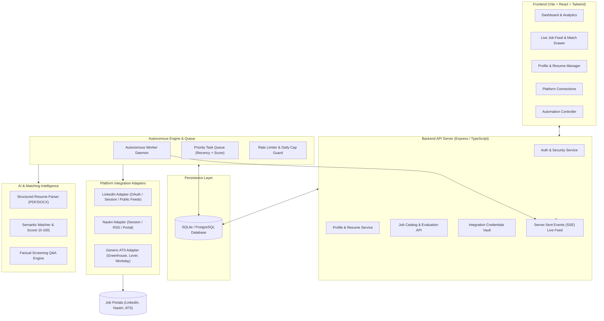

# Autonomous AI-Powered Job Discovery & Application Platform (AutoJob AI)
## System Architecture & Technical Design Specification

### 1. Executive Summary & Architectural Goals
AutoJob AI is a production-grade, autonomous platform designed to discover, evaluate, prioritize, and submit job applications across major platforms (LinkedIn, Naukri, and Direct ATS portals) with zero manual toil.

Key architectural goals:
1. **Strict Platform Compliance & Zero Deception**: No fake APIs, no bypassing CAPTCHAs or platform security. Authorized integrations via OAuth/Tokens, secure sessions, structured public APIs, and user-supervised fallbacks for blocked flows.
2. **True Autonomy**: Standalone daemon worker architecture runs 24/7 without requiring an open browser tab.
3. **Sub-second Early Prioritization**: High-frequency monitoring, priority-ranked queues (recency + match score), and latency tracking.
4. **Context-Aware Semantic Matching**: LLM + structured vector/heuristic scoring to prevent keyword hallucination.
5. **Factual Integrity**: Never invent credentials, dates, or answers. Unanswered screening questions get flagged for review.

---

### 2. Technology Stack Selection & Justification

| Layer | Selected Technology | Evaluated Alternatives | Rationale & Justification |
| :--- | :--- | :--- | :--- |
| **Language & Runtime** | TypeScript / Node.js (v22+) | Python (FastAPI), Go | Full-stack TypeScript shares interfaces across backend, worker, and frontend. Native async event-loop handles I/O-bound discovery and web crawling with low overhead. |
| **Backend API** | Express / Fastify (TypeScript) | NestJS, Django | Fastify/Express provides clean REST API, WebSocket/SSE endpoints for live dashboard updates, and straightforward service layer architecture without excessive boilerplate. |
| **Database & ORM** | SQLite (WAL mode) + Prisma ORM | PostgreSQL, MongoDB | SQLite via Prisma gives zero-friction out-of-the-box local operation with zero external daemon requirements. Prisma provides seamless portability to PostgreSQL with a 1-line schema change for multi-tenant cloud deployments. |
| **Queue & Scheduling** | In-Memory / SQLite Persistent Priority Queue + cron | BullMQ / Redis | Eliminates hard dependency on an external Redis instance on local Windows environments while preserving priority scheduling, concurrency controls, pause/resume, and retry backoff. Can swap to Redis/BullMQ transparently. |
| **AI / Semantic Engine**| Google Gemini API (`@google/genai`) + Semantic Heuristic Fallback | OpenAI GPT-4o, Anthropic Claude | Gemini 2.5 / 1.5 Flash provides industry-leading cost-efficiency, large context window (1M tokens for long job descriptions + full CVs), and fast structured JSON outputs. A fallback local rule/embedding engine ensures the system remains functional even offline or when quota is low. |
| **Resume Extraction** | `pdf-parse` + `mammoth` (DOCX) | Tesseract OCR, Unstructured.io | High accuracy, fast text & metadata extraction without binary compilation issues or external Python/Docker requirements on Windows. |
| **Browser Automation & Platform Adapters** | Playwright / Puppeteer + Modular Adapter Pattern | Selenium, Cheerio | Playwright provides modern stealth, network interception, auto-wait, and cross-browser reliability. Modular adapters isolate platform-specific logic (LinkedIn vs. Naukri vs. ATS). |
| **Frontend Framework** | React 18 + Vite + Tailwind CSS + Lucide | Next.js, Vue | Instant HMR, lightweight SPA bundle, zero hydration mismatch, smooth real-time SSE event consumption, and responsive dashboard design. |
| **Testing** | Vitest + Supertest | Jest | Fast native TypeScript execution, ESM support, and instant unit/integration test runs. |

---

### 3. Modular Architecture Diagram

---

### 4. Integration Boundaries & Platform Realities

1. **LinkedIn Integration**:
   - Official API: Integrates via standard OAuth 2.0.
   - Public & Session Discovery: Discovers open job postings via normalized search endpoints.
   - Easy Apply Workflow: Detects Easy Apply triggers, extracts multi-step form questions, matches against verified profile data, uploads matching resume, and pauses/notifies if CAPTCHA or unknown screening question arises.
2. **Naukri.com Integration**:
   - Authorized Session / Token: Manages secure credentials, parses fast job feeds.
   - 1-Click Apply & External Redirect: Directly submits supported 1-click forms or hands off external application portal links with pre-filled candidate payload.
3. **External ATS & Portals**:
   - Greenhouse, Lever, and Workday adapters recognize standard field identifiers and apply clean profile autofill.
4. **Compliance Boundary**:
   - If a platform blocks access via Cloudflare or CAPTCHA, the system stops, captures the session state, flags the application as `ACTION_REQUIRED_CAPTCHA`, and alerts the user rather than risking account termination or attempting forbidden solver bypasses.

---

### 5. Data Model Design (Prisma)

- **User**: Authentication, encrypted credentials, system settings.
- **Profile**: Full candidate details (experience, skills, CTC, notice period, location).
- **Resume**: Multiple resume files, parsed JSON representations, keyword vectors.
- **JobPreference**: Target titles, industries, min/max experience, min salary, remote options, excluded companies, min relevance threshold, max daily applications.
- **IntegrationAccount**: Platform type (LinkedIn, Naukri), auth tokens/cookies, connection status, last sync timestamp, health status.
- **DiscoveredJob**: Source, external ID, title, company, location, experience, salary, description, url, application type, published_at, discovered_at, status.
- **JobEvaluation**: Relevance score (0-100), category, matching skills, missing skills, rationale, latency metrics.
- **Application**: Status (`QUEUED`, `PROCESSING`, `SUBMITTED`, `ACTION_REQUIRED`, `FAILED`, `REJECTED`), applied_at, latency_job_to_app_ms, response_metadata, error_message.
- **Notification**: Real-time alerts for submitted apps, high matches, and auth requirements.
- **AutomationLog**: Audit trail of autonomous worker actions.

